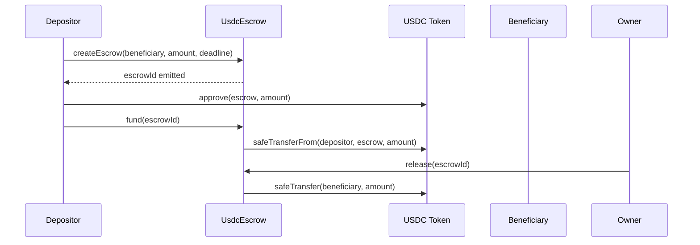

# UsdcEscrow — Smart Contract Design Doc

**Status:** Draft  
**Target chain:** Arc Testnet (EVM, Cancun, chain ID 1516)  
**Language / toolchain:** Solidity 0.8.28, Foundry (forge)  
**Milestone:** v1.0 — immutable, single-owner  

---

## Review Tracker

- [ ] Design Review
- [ ] Security Review
- [ ] Ops Review

**Action Items (living):** *(empty at first draft)*

---

## 1. Goals / Non-Goals

### Goals
- Hold USDC in escrow between a depositor and a beneficiary.
- Enforce a clear state machine: `Pending → Funded → Released | Refunded`.
- Allow the depositor to reclaim funds after an expiry deadline passes without an owner decision.
- Allow the owner (arbitrator) to release funds to the beneficiary or refund the depositor at any time before expiry.
- Support multiple concurrent escrow instances, each identified by a `uint256 escrowId`.
- Emit rich events for every lifecycle transition.

### Non-Goals
- Multi-token support (no ETH, no arbitrary ERC-20 — USDC only).
- Dispute / contested state (owner release/refund is the only arbitration path).
- Milestone / partial releases.
- Upgradeability.
- Cross-chain transfers.
- Fee collection.

---

## 2. Requirements

### Functional
- FR-1: Any address may create an escrow by calling `createEscrow(beneficiary, amount, deadline)`.
- FR-2: The depositor must fund the escrow with exactly `amount` USDC within the same call or a subsequent `fund()` call.
- FR-3: Once funded, the state cannot be changed except by the owner (release/refund) or by the depositor after the deadline (reclaim).
- FR-4: Owner may call `release(id)` to push USDC to the beneficiary.
- FR-5: Owner may call `refund(id)` to push USDC back to the depositor.
- FR-6: Depositor may call `reclaim(id)` if `block.timestamp > deadline` and the escrow is still `Funded`.
- FR-7: All three resolution paths set the state to `Released` or `Refunded`, preventing double-spend.

### Security
- SR-1: No path allows re-entrancy to drain funds.
- SR-2: No path lets a non-owner call `release` or `refund`.
- SR-3: A funded escrow can never enter `Funded` again (no re-funding).
- SR-4: A resolved escrow (Released or Refunded) is permanently terminal.
- SR-5: The `amount` stored in the escrow is the actual transferred amount — validated via balance delta.
- SR-6: Zero-address beneficiary and zero-amount escrows are rejected at creation.
- SR-7: Deadline must be in the future at creation time.

---

## 3. Terminology & Actors

| Term | Definition |
|---|---|
| Escrow | A single USDC lock-and-release agreement with a unique `escrowId` |
| Depositor | The address that creates and funds the escrow |
| Beneficiary | The address that receives USDC upon release |
| Owner / Arbitrator | The contract deployer; the only address that can call `release` or `refund` |
| Deadline | Unix timestamp after which the depositor may reclaim without owner approval |

### Actors table

| Actor | On/Off-chain | Trust level | Capabilities |
|---|---|---|---|
| Owner | On-chain EOA | Trusted | `release`, `refund`, `transferOwnership` (two-step) |
| Depositor | On-chain EOA/contract | Untrusted | `createEscrow`, `fund`, `reclaim` (after deadline) |
| Beneficiary | On-chain EOA/contract | Untrusted | Receives USDC on release — no active calls |
| USDC contract | On-chain ERC-20 | Semi-trusted | Token transfer counterparty |

---

## 4. Language / Runtime

- **Language:** Solidity 0.8.28 (checked arithmetic by default; no `unchecked` needed for counters).
- **EVM hardfork:** Cancun — available in the Arc Testnet environment.
- **Base contracts:** OpenZeppelin 5.6.1 (`Ownable2Step`, `ReentrancyGuard`, `SafeERC20`, `IERC20`).
- **Why `Ownable2Step`:** Two-step ownership transfer prevents accidental loss of the arbitrator role; `renounceOwnership` is overridden to revert.

---

## 5. Transaction & Execution Model

Execution is atomic (all state committed or all reverted). Every function that transfers USDC follows **Checks-Effects-Interactions (CEI)**:

1. Check: validate state and inputs.
2. Effect: update state (set `status`, zero `amount`).
3. Interact: call `safeTransfer` / `safeTransferFrom`.

`nonReentrant` is applied to every function that moves USDC, as a belt-and-suspenders guard alongside CEI.

---

## 6. Architecture Overview

### State machine

```
          createEscrow()
               │
               ▼
           [Pending]
               │  fund()
               ▼
           [Funded]──── reclaim() (after deadline) ──▶ [Refunded]
               │
        ┌──────┴──────┐
   release()       refund()
        │               │
        ▼               ▼
   [Released]      [Refunded]
```

### Sequence: happy path (release)



### Flow of funds

| Step | Who moves what | Invariant |
|---|---|---|
| `fund()` | Depositor → UsdcEscrow (safeTransferFrom) | `escrow.amount == actual USDC received` |
| `release()` | UsdcEscrow → Beneficiary (safeTransfer) | State set to Released BEFORE transfer |
| `refund()` | UsdcEscrow → Depositor (safeTransfer) | State set to Refunded BEFORE transfer |
| `reclaim()` | UsdcEscrow → Depositor (safeTransfer) | State set to Refunded BEFORE transfer; deadline must have passed |

**Resting-state invariant:** After any resolution, the contract holds no USDC attributable to that escrow.

### External dependencies

| Dependency | Address source |
|---|---|
| USDC ERC-20 (Arc Testnet) | Constructor argument (validated non-zero); sourced from `@/onchain-facts` |
| OpenZeppelin 5.6.1 | `node_modules/@openzeppelin/contracts` (pre-installed) |

---

## 7. Contract Design

### Roles

| Role | Holder | Permissions | Blast radius if compromised |
|---|---|---|---|
| Owner | Deployer (single EOA) | `release`, `refund`, `transferOwnership` | Can force-release or force-refund any funded escrow — misappropriates depositor or beneficiary funds |
| Depositor | Per-escrow address | `createEscrow`, `fund`, `reclaim` (after deadline) | Can only affect their own escrows |

### Storage layout

```solidity
enum EscrowStatus { Pending, Funded, Released, Refunded }

struct EscrowInfo {
    address depositor;   // 20 bytes
    address beneficiary; // 20 bytes
    uint256 amount;      // 32 bytes — USDC amount (6 decimals)
    uint256 deadline;    // 32 bytes — Unix timestamp
    EscrowStatus status; // 1 byte (uint8)
}

// State variables
IERC20 public immutable usdc;          // set in constructor
uint256 private _escrowCounter;        // auto-incremented ID
mapping(uint256 => EscrowInfo) private _escrows;
```

No upgradeable proxy; no `__gap` needed.

### Modifiers

| Modifier | Guard |
|---|---|
| `onlyOwner` | Caller is the current owner (from `Ownable2Step`) |
| `nonReentrant` | Reentrancy guard on all fund-moving functions |
| `escrowExists(id)` | `_escrows[id].depositor != address(0)` |

### Functions — writes

| Function | Caller | State mutated | Events | Revert conditions |
|---|---|---|---|---|
| `createEscrow(beneficiary, amount, deadline)` | Any address | Creates `EscrowInfo{Pending}`, increments counter | `EscrowCreated(id, depositor, beneficiary, amount, deadline)` | beneficiary is zero, amount is 0, deadline ≤ now |
| `fund(escrowId)` | Depositor only | `status → Funded` | `EscrowFunded(id, amount)` | Not depositor, not Pending, transfer fails |
| `release(escrowId)` | Owner | Amount zeroed, `status → Released` | `EscrowReleased(id, beneficiary, amount)` | Not owner, not Funded |
| `refund(escrowId)` | Owner | Amount zeroed, `status → Refunded` | `EscrowRefunded(id, depositor, amount)` | Not owner, not Funded |
| `reclaim(escrowId)` | Depositor | Amount zeroed, `status → Refunded` | `EscrowRefunded(id, depositor, amount)` | Not depositor, not Funded, deadline not passed |
| `transferOwnership(newOwner)` | Current owner | Pending owner queued | `OwnershipTransferStarted` | Inherited from `Ownable2Step` |
| `acceptOwnership()` | Pending owner | Owner updated | `OwnershipTransferred` | Inherited from `Ownable2Step` |
| `renounceOwnership()` | — | Reverts always | — | Always reverts (safety override) |

### Events

| Event | Params | When |
|---|---|---|
| `EscrowCreated` | `id, depositor, beneficiary, amount, deadline` | `createEscrow` succeeds |
| `EscrowFunded` | `id, amount` | `fund` succeeds |
| `EscrowReleased` | `id, beneficiary, amount` | `release` succeeds |
| `EscrowRefunded` | `id, depositor, amount` | `refund` or `reclaim` succeeds |

All addresses and IDs are indexed for log filtering.

---

## 8. Deployment & Initialization

- **Constructor args:** `address usdcToken` (USDC ERC-20 on Arc Testnet), `address initialOwner`.
- `initialOwner` is passed to `Ownable2Step`'s constructor; the deployer wallet fills this role.
- No `initialize()` — immutable, no proxy.
- USDC address for Arc Testnet is read from `@/onchain-facts` (`getUsdc(chainId).address`); never hardcoded.
- No minimum balance required at deploy.

---

## 9. Upgradeability

**Not upgradeable.** Immutable by design. Migration path: deploy a new contract at a new address; instruct integrators to re-point. No state migration is necessary because each escrow is self-contained.

---

## 10. Key Management & Signing

No off-chain signatures. All authorization is purely onchain (`msg.sender` checks). The owner key is a single EOA on Arc Testnet; for production, a multi-sig is strongly recommended.

---

## 11. Security Considerations

| Vulnerability | Applicable? | Mitigation |
|---|---|---|
| Reentrancy | Yes — `safeTransfer` / `safeTransferFrom` are external calls | CEI ordering + `nonReentrant` on all fund-moving functions |
| Access control | Yes | `onlyOwner` on `release`/`refund`; depositor check on `fund`/`reclaim` |
| Integer overflow/underflow | Solidity 0.8.28 checked | No `unchecked` blocks |
| Unchecked external call | Yes — USDC is an external contract | `SafeERC20.safeTransfer` / `safeTransferFrom` handle non-standard returns |
| Fee-on-transfer tokens | N/A — USDC on Arc has no fee | USDC is the only accepted token; no fee mechanism |
| Signature replay | N/A — no off-chain signatures used | — |
| Front-running / MEV | Low — owner is trusted arbitrator | No auction or price-sensitive path |
| Flash-loan / price manipulation | N/A — no price oracle | — |
| Oracle manipulation | N/A | — |
| Denial of service | Low — pull-over-push model; no loops | Each escrow resolved independently |
| Delegatecall / proxy safety | N/A — immutable, no proxy | — |
| Timestamp / block dependence | Yes — deadline uses `block.timestamp` | Tolerance is minutes; not used for randomness; miners cannot manipulate by more than ~15 s |
| Approval persistence | Yes — depositor approves before `fund()` | Only exact-amount approval needed; no dangling max-approvals encouraged in docs |
| Centralization risk | Yes — single owner can force-resolve | Documented in trust model; two-step ownership transfer mitigates accidental handoff |

---

## 12. Trust Model & Threat Analysis

| Actor | Worst-case if key compromised | Mitigation | Detection |
|---|---|---|---|
| Owner | Force-release or force-refund ALL funded escrows | Two-step ownership transfer limits accidental handoff; for prod use multisig | `EscrowReleased` / `EscrowRefunded` events; monitor for unexpected resolutions |
| Depositor | Destroy their own escrow (reclaim after deadline) | No other depositor's funds are at risk | Per-escrow event monitoring |

---

## 13. Emergency Response

- **No pause mechanism** (immutable contract, no upgrades). Post-deploy the only emergency tool is the owner's `refund` function to return funds to depositors.
- For production, replace single-owner with a multi-sig + timelock and add an `emergencyPause` guarded by a separate Pauser.

---

## 14. Failure Scenarios

| Scenario | Outcome |
|---|---|
| Depositor approves less than `amount` | `safeTransferFrom` reverts; escrow stays `Pending` |
| Owner calls `release` on a `Refunded` escrow | Reverts — status guard |
| Depositor calls `reclaim` before deadline | Reverts — `block.timestamp <= deadline` check |
| USDC contract is paused (Circle compliance) | `safeTransfer` / `safeTransferFrom` reverts; escrow stays in current state; owner can retry when USDC is unpaused |
| Two parties race to call `reclaim` and `release` simultaneously | Only one wins; the other reverts on the status guard — no double-spend |

---

## 15. Testing Strategy

- **Unit tests (Foundry):** happy path, all revert paths, event assertions, fuzz on `amount` and `deadline`, invariant: sum of USDC held by contract equals sum of funded non-resolved escrow amounts.
- **Static analysis (Slither):** run against `UsdcEscrow.sol`; treat High as actionable.
- **Integration tests (post-deploy):** exercise full lifecycle on Arc Testnet fork.
- **Coverage target:** ≥ 95% branch coverage.
- Run full suite: `forge test -vvv && forge coverage`.

---

## 16. Third-Party Libraries

| Library | Version | Already a dep? | Why | Security reviewed? |
|---|---|---|---|---|
| `@openzeppelin/contracts` | 5.6.1 | Yes | `Ownable2Step`, `ReentrancyGuard`, `SafeERC20` | Yes (OZ audit trail) |
